# Methodology: what was done at each step, why, and what it changed

Every number below was produced by the scripts in `scripts/` and is saved in `reports/`. Re-running
`make all` regenerates all of them with the same seeds.

**Metrics used throughout**
* **ROC-AUC**: how well the model ranks a person with diabetes above one without (0.5 = coin flip).
* **PR-AUC**: precision averaged over recall. More informative than ROC-AUC when positives are rare.
* **Brier score**: mean squared error of the predicted probabilities (lower is better). Rewards honest probabilities.
* **ECE** (expected calibration error): average gap between predicted risk and observed rate.
* **Recall / precision at the screening threshold**: the numbers a clinic would actually experience.

---

# Part 1 · Pima Indians Diabetes (768 patients)

## 1.1 Validation design

| Decision | Why |
|---|---|
| **No single train/test split.** Every result is the mean ± sd over the same **50 folds** (5-fold stratified CV repeated 10 times). | With 154 test patients, one split is noisy. Re-running the original notebook's method on 50 different random splits gave test AUCs from **0.751 to 0.870**; its reported 0.828 was one draw from that range. |
| **Every preprocessing step lives inside a scikit-learn / imbalanced-learn `Pipeline`.** | Imputation, scaling, feature engineering and SMOTE are fitted on the training part of each fold only, so no information from validation patients leaks into training. |
| **Nested CV for anything tuned.** | The inner loop chooses hyperparameters; the outer loop scores them on patients the tuning never saw. Otherwise the reported score includes the luck of the search. |
| **Model comparisons use the Nadeau–Bengio corrected t-test.** | CV folds share most of their training data, so a plain paired t-test over folds is overconfident. The correction gives honest p-values. |
| **Screening goal fixed in advance: catch ≥ 85% of diabetes cases.** | Missing a case costs more than a false alarm in screening. Fixing the goal before looking at results avoids choosing whichever threshold looks best. |

## 1.2 What was wrong with the original notebook

| Issue | Effect |
|---|---|
| KNN imputation fitted on all 768 rows before splitting | Test patients influenced the values imputed for training patients (leakage) |
| SMOTE applied before the grid search's cross-validation | Synthetic copies of a patient landed in both training and validation folds, inflating the scores used to pick hyperparameters |
| Best model chosen by its score on the test set | The test set became part of model selection, so the reported test score is optimistic |
| KNN imputer run on unscaled features | Insulin (0–846) dominated the distance; it is also 49% missing |
| Depth-9 XGBoost on 614 rows | High-variance model that memorises; worst calibration of anything tested |
| "79.9% accuracy is excellent"; "F1 = 73% of diabetic cases" | Always predicting "no diabetes" scores 65% accuracy. F1 is not a share of cases; recall (77.8%) is |

## 1.3 Ablation: one change at a time (`reports/pima/ablation.csv`)

All rows use the same 50 folds. p-values compare each row with row A.

| Step | ROC-AUC | PR-AUC | Brier | Kept? | Why |
|---|---|---|---|---|---|
| **A.** Original model (KNN impute → 10 features → SMOTE → depth-9 XGBoost), re-tested leak-free | 0.817 ± 0.028 | 0.682 | 0.186 | – | Honest starting point |
| **B.** Logistic regression on raw values (zeros left in) | 0.829 ± 0.028 | 0.722 | 0.158 | ✓ | A regularised linear model has far lower variance on 768 rows |
| **C.** + zeros recoded to missing, median-imputed inside each fold | 0.835 ± 0.028 | 0.722 | 0.157 | ✓ | A blood pressure of 0 is not a measurement; treating it as one distorts the fit |
| **D.** + missing-value indicator columns | 0.832 ± 0.027 | 0.721 | 0.158 | ✗ | Tested because "insulin not measured" might carry signal. It didn't, so it was dropped |
| **E.** + clinical threshold flags (glucose ≥ 140, BMI ≥ 30, diastolic ≥ 80, HOMA-style index) | 0.829 ± 0.028 | 0.724 | 0.159 | ✗ | Hard thresholds throw away information the model already has from the raw values |
| **F.** + the notebook's 10 engineered features (squares and interactions) | 0.841 ± 0.026 | 0.729 | 0.154 | Replaced by G | The squared terms helped, which pointed to non-linear effects |
| **G.** **Cubic splines for Age and BMI** (instead of D–F) | 0.846 ± 0.025 | 0.732 | 0.152 | ✓ | Splines model a smooth non-linear curve with few parameters, which is the principled version of F |
| **H.** **+ regularisation strength tuned by nested CV** (final) | **0.849 ± 0.026** | **0.732** | **0.152** | ✓ | C chosen from 11 values in an inner loop; scored on outer folds |

**Net improvement: +0.032 ROC-AUC (p = 0.001, corrected t-test), +0.050 PR-AUC, Brier 0.186 → 0.152.**

Note on honesty: steps D–G were compared on the same CV folds, so choosing G over F used those folds.
With only 768 patients there is no untouched test set. The nested-CV estimate for H and the small,
consistent gaps (each well under one standard deviation) are the safeguards; treat 0.85 as the
expected performance, give or take 0.03.

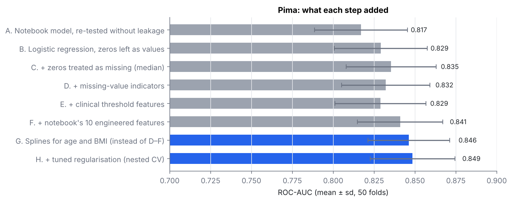

### What the splines learned
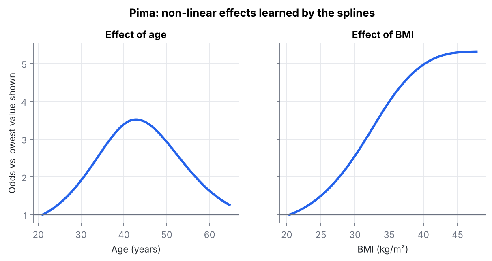

* **BMI**: risk rises steeply from 25 to 40 and then levels off, which a straight line cannot represent.
* **Age**: risk rises until the early 40s and then falls. This most likely reflects the cohort (older
  women in the study who had *not* developed diabetes), not a real decline in risk with age. It is a
  reason not to apply this model to other populations.

## 1.4 Model families on identical folds (`reports/pima/model_comparison.csv`)

| Model | ROC-AUC | PR-AUC | Brier | p vs final |
|---|---|---|---|---|
| **Logistic regression + splines (final, C = 1)** | **0.846** | **0.732** | **0.152** | – |
| Stacking (logistic + random forest + XGBoost → logistic) | 0.845 | 0.728 | 0.154 | 0.69 |
| Soft vote (logistic + shallow XGBoost) | 0.843 | 0.727 | 0.154 | 0.46 |
| Logistic regression, notebook features | 0.841 | 0.729 | 0.154 | 0.13 |
| Random forest (min 5 per leaf) | 0.839 | 0.721 | 0.155 | 0.22 |
| LightGBM (4 leaves) | 0.833 | 0.708 | 0.160 | 0.06 |
| SVM, RBF kernel | 0.831 | 0.722 | 0.161 | 0.05 |
| XGBoost, depth 2, native missing values | 0.828 | 0.706 | 0.162 | 0.047 |
| Original notebook model | 0.817 | 0.682 | 0.186 | 0.003 |
| k-nearest neighbours (k = 25) | 0.811 | 0.680 | 0.168 | 0.001 |

Ensembles were tried (soft voting, stacking) and did not beat the single logistic model; the
differences are far inside the noise. **The simplest model that is as good as anything else was
chosen**, because it is also the easiest to explain to a clinician.

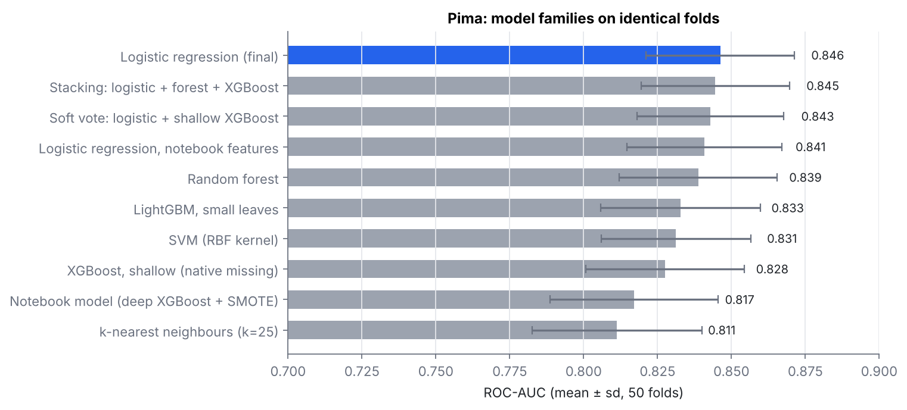

## 1.5 Class imbalance (`reports/pima/imbalance.csv`)

| Strategy | ROC-AUC | PR-AUC | Brier |
|---|---|---|---|
| **No re-weighting (kept)** | 0.846 | 0.732 | **0.152** |
| Class weights "balanced" | 0.846 | 0.733 | 0.161 |
| SMOTE inside each fold | 0.846 | 0.732 | 0.160 |

Re-weighting and SMOTE did not change the ranking at all; they only pushed predicted probabilities
up, which made them less accurate (worse Brier). The imbalance (35% positive) is handled where it
belongs: in the choice of decision threshold.

## 1.6 Calibration (`reports/pima/calibration.csv`, out-of-fold)

| Model | Brier | ECE |
|---|---|---|
| Original notebook model (SMOTE + deep XGBoost) | 0.186 | **0.117** |
| Logistic, class-balanced | 0.162 | 0.098 |
| **Logistic (final)** | **0.153** | **0.035** |
| Logistic + Platt scaling | 0.153 | 0.032 |

The final model's probabilities are already close to the observed rates, so Platt scaling adds almost
nothing and was not added. When the original model predicted about 80% risk, only about 57% of those
patients actually had diabetes (SMOTE inflates probabilities).

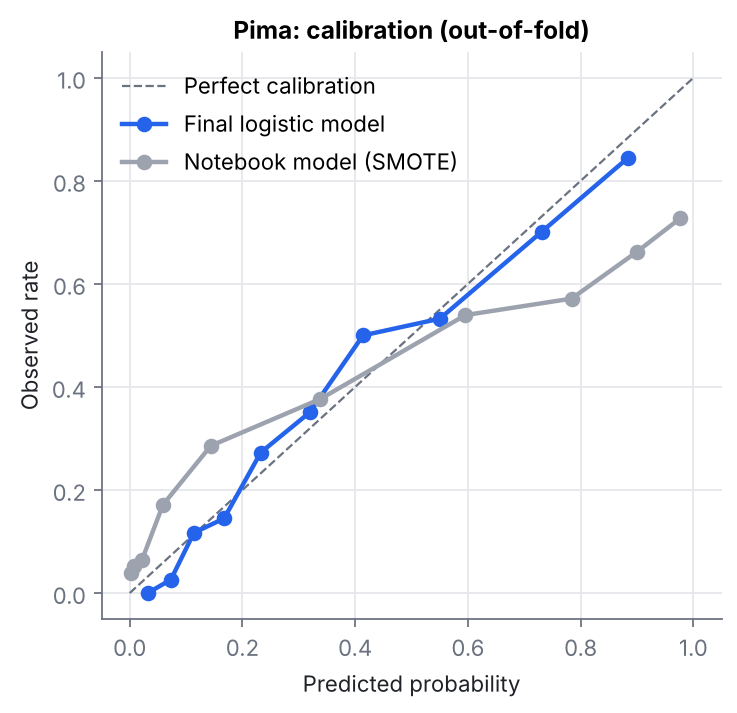

## 1.7 Screening threshold (`reports/pima/threshold.csv`)

The threshold is chosen on **inner** out-of-fold predictions (training part only) as the highest
threshold that still reaches 85% recall, then measured on the **outer** fold it never saw
(5 × 5 repeated CV).

| Setting | Threshold | Recall | Precision | Specificity | Accuracy | Flagged per 1,000 |
|---|---|---|---|---|---|---|
| **Final model, screening threshold** | 0.26 | **84.2%** | 58.4% | 67.6% | 73.4% | 505 |
| Final model, default 0.5 | 0.50 | 56.1% | 72.4% | 88.4% | 77.1% | 272 |
| Original model, screening threshold | 0.16 | 86.3% | 56.3% | 63.7% | 71.6% | 538 |

At the default threshold the model misses 44% of diabetes cases. The screening threshold catches 84%
(target 85%, achieved on unseen folds), at the cost of more follow-up tests. Accuracy goes *down*
on purpose: accuracy is the wrong goal for screening.

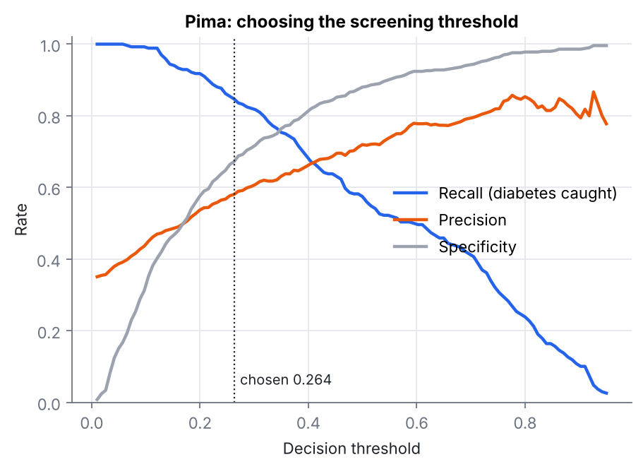

## 1.8 Explainability (`reports/pima/odds_ratios.csv`, `permutation_importance.csv`)

| Feature | Odds ratio per 1 SD | ROC-AUC drop when shuffled |
|---|---|---|
| Glucose | **3.09** | **0.193** |
| BMI (spline, see curve) | – | 0.034 |
| Age (spline, see curve) | – | 0.029 |
| Diabetes pedigree function | 1.33 | 0.010 |
| Pregnancies | 1.24 | 0.006 |
| Skin thickness | 1.09 | 0.001 |
| Insulin | 0.94 | 0.000 |
| Blood pressure | 0.93 | −0.001 |

Glucose from the oral glucose tolerance test dominates, as expected clinically. Insulin and blood
pressure add nothing once glucose and BMI are known.

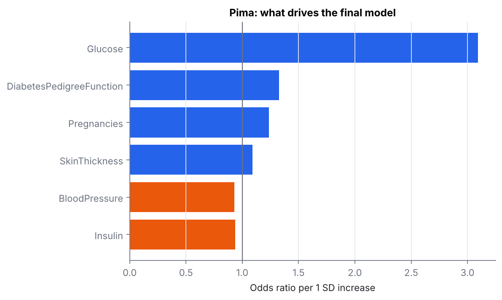

---

# Part 2 · CDC Diabetes Health Indicators (253,680 adults)

## 2.1 Validation design

| Decision | Why |
|---|---|
| **20% hold-out test set (50,736 people), locked until the end and scored once.** | With this much data a single test set is precise (95% CI on AUC ≈ ±0.005), so it gives a clean, final number. |
| **Grouped split: identical rows always stay together.** 9.5% of rows are exact duplicates. | If a copy of a test row sits in the training set, a flexible model can "remember" its label. A memorising random forest scored **0.809 AUC with random folds but 0.799 with grouped folds**: duplicates would have inflated the score by 0.010 (`reports/cdc/duplicate_leakage.csv`). |
| **All model choices use 5-fold stratified, grouped CV on the training set only.** | The test set plays no part in choosing features, models, hyperparameters, calibration or the threshold. |
| **Hyperparameters: 25-trial random search** (LightGBM: leaves, learning rate, trees, min child samples, L2, row and column subsampling), 3 grouped folds. | Random search covers a 7-dimensional space far more efficiently than a grid. With 200k rows the search's own optimism is negligible, and the locked test set confirms it. |
| **Same screening goal as Pima: ≥ 85% recall.** | Fixed before modelling. |

## 2.2 Ablation (`reports/cdc/ablation.csv`, 5 grouped folds)

| Step | ROC-AUC | PR-AUC | Brier | Kept? | Why |
|---|---|---|---|---|---|
| **A.** One question: self-rated general health | 0.730 | 0.263 | – | – | Shows how much a single strong question already explains |
| **B.** Logistic regression, 21 raw answers | 0.822 | 0.406 | 0.0990 | – | Linear baseline |
| **C.** + one-hot encoding of age, income, education and general health; cubic spline for BMI; counts of cardiometabolic conditions, unhealthy days and healthy habits | 0.827 | 0.428 | 0.0972 | ✓ | Ordinal answers do not have equal steps (age band 13 is not "13× band 1"); BMI risk is non-linear |
| **D.** LightGBM, default settings | 0.829 | 0.431 | 0.0968 | ✓ | Gradient-boosted trees find interactions (e.g. age × BMI × blood pressure) automatically |
| **E.** **LightGBM, tuned (final)** | **0.831** | **0.436** | **0.0965** | ✓ | Fewer, larger leaves (min 244 samples), slower learning rate (0.021), column subsampling (0.53) |
| **F.** Soft vote: tuned LightGBM + logistic (C) | 0.830 | 0.435 | 0.0965 | ✗ | No gain over E, so the simpler single model was kept |

The fold-to-fold standard deviation is about 0.002. The jump from the one-question rule to logistic
regression and the B → C feature step are well beyond that; D and E add smaller but consistent gains
on the same folds. **Net gain over the logistic baseline: +0.009 ROC-AUC, +0.030 PR-AUC (+7% relative).**

Other model families on the same folds: XGBoost 0.830, random forest 0.826.

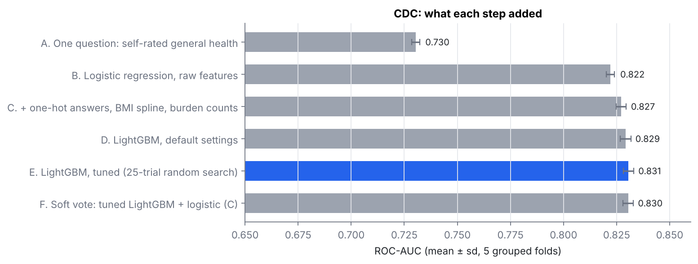

**Why the gains are small.** 1,566 answer patterns appear with *both* labels: the survey cannot tell
those people apart. Self-reported, mostly yes/no answers put a ceiling on any model: every model family
tested here, from logistic regression to tuned gradient boosting, landed between 0.822 and 0.831.

## 2.3 Class imbalance (`reports/cdc/imbalance.csv`)

| Strategy | ROC-AUC | PR-AUC | Brier |
|---|---|---|---|
| **No re-weighting (kept)** | 0.831 | 0.436 | **0.097** |
| Class weights "balanced" | 0.831 | 0.435 | 0.174 |
| Random undersampling of the majority class | 0.829 | 0.429 | 0.177 |

Same conclusion as Pima, more strongly: re-balancing does not improve ranking but nearly **doubles the
Brier score**, because it makes the model believe diabetes is 50% common instead of 14%. The 14% base
rate is handled by the threshold instead.

## 2.4 Calibration

Out-of-fold expected calibration error was **0.0028**, so no extra calibration step was needed (the
pipeline applies isotonic calibration automatically only if ECE > 0.01). On the test set ECE is
**0.0025**: when the model says 20%, about 20% of those people report diabetes.

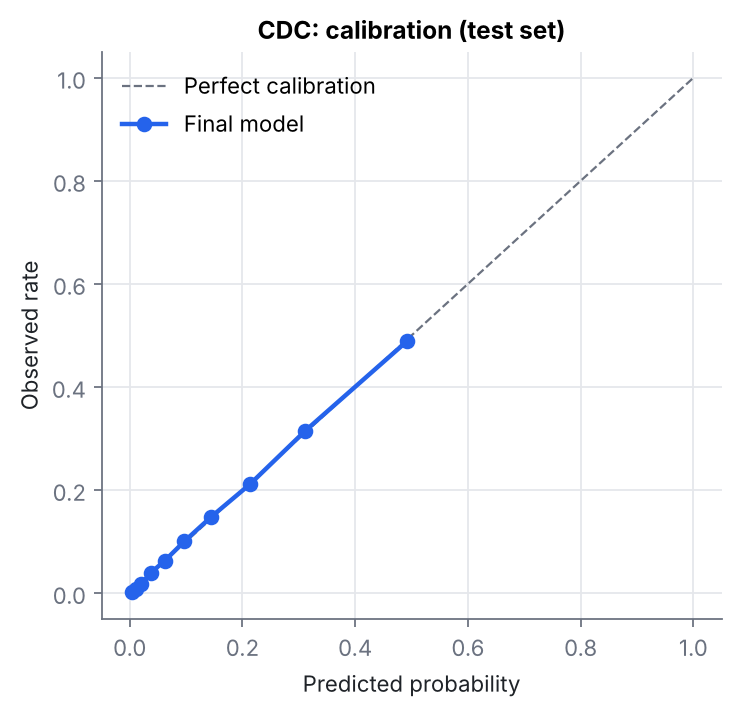

## 2.5 Final test-set result (scored once, `reports/cdc/summary.json`)

| Metric | Final model | 95% bootstrap CI | Logistic baseline |
|---|---|---|---|
| ROC-AUC | **0.832** | 0.827 – 0.836 | 0.822 |
| PR-AUC | **0.434** | 0.422 – 0.446 | 0.400 |
| Brier score | **0.0965** | 0.0948 – 0.0981 | 0.0994 |
| ECE | **0.0025** | – | 0.0143 |

The test score matches cross-validation (0.831), which confirms nothing leaked into model selection.

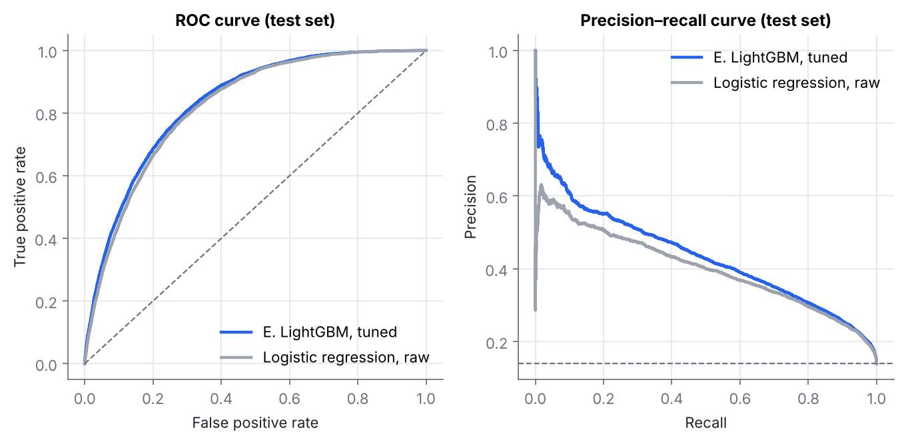

## 2.6 Screening threshold (chosen on training out-of-fold predictions, measured on test)

| Setting | Threshold | Recall | Precision | Specificity | Accuracy | Flagged per 1,000 |
|---|---|---|---|---|---|---|
| **Screening threshold** | 0.110 | **85.2%** | 28.3% | 65.1% | 67.9% | 419 |
| Default 0.5 | 0.500 | 15.6% | 56.1% | 98.0% | 86.5% | 39 |

The default threshold looks better on accuracy (86.5%) but **misses 84% of people with diabetes**; it
barely beats predicting "no diabetes" for everyone (86.1% accuracy). The screening threshold hit its
85% target on unseen data. The cost is that about 3 in 10 people flagged for a blood test will have
diabetes or prediabetes, which is reasonable for a cheap first-line screen.

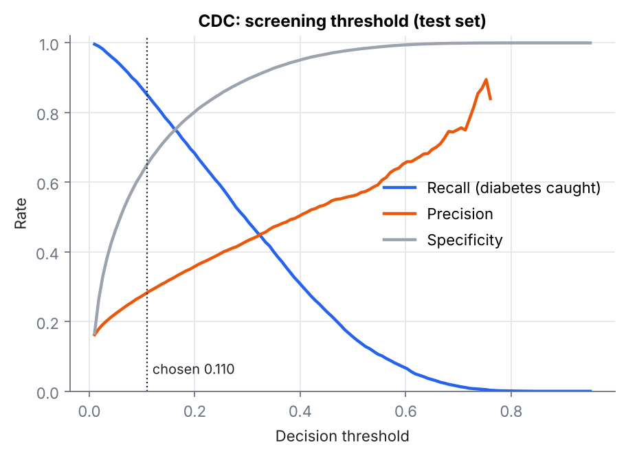

## 2.7 Subgroup performance (test set, `reports/cdc/subgroups.csv`)

| Group | n | Prevalence | ROC-AUC | Recall at threshold | Flagged per 1,000 |
|---|---|---|---|---|---|
| Female | 28,443 | 12.9% | 0.842 | 84.2% | 384 |
| Male | 22,293 | 15.3% | 0.818 | 86.4% | 464 |
| Age 18–44 | 10,786 | 3.9% | 0.861 | **50.4%** | 92 |
| Age 45–64 | 22,022 | 13.6% | 0.833 | 83.6% | 396 |
| Age 65+ | 17,928 | 20.4% | 0.766 | 90.6% | 644 |
| Income < $20k | 7,463 | 24.2% | 0.781 | 93.0% | 679 |
| Income $20k–50k | 16,513 | 16.3% | 0.805 | 88.4% | 525 |
| Income ≥ $50k | 26,760 | 9.6% | 0.846 | 76.4% | 282 |
| No health coverage | 2,429 | 11.4% | 0.846 | 79.0% | 336 |

**Findings to act on:**
* **Younger adults:** one global threshold catches only **half** of cases aged 18–44, because their
  predicted risks are low across the board. A deployment should use an age-specific threshold, or
  screen this group by other criteria.
* **Older and lower-income groups:** ranking is weaker (AUC 0.77–0.78) because diabetes is common
  there and harder to separate from other conditions; the threshold flags most of these respondents.
* Differences reflect both the model and real prevalence differences; they are reported so they can be
  monitored, not hidden.

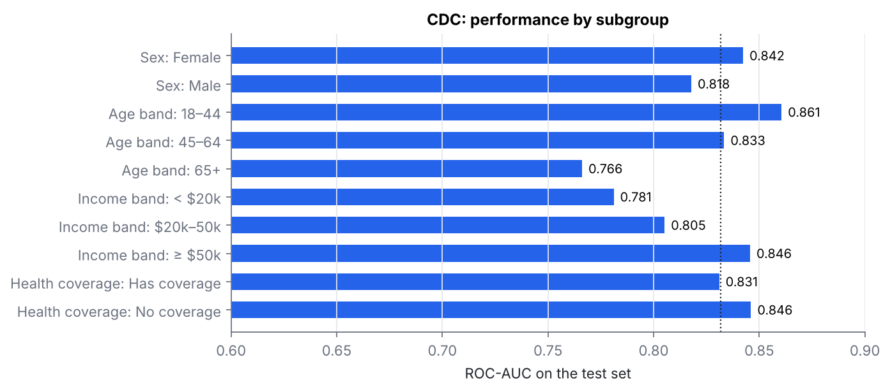

## 2.8 Explainability (SHAP on 4,000 test respondents, `reports/cdc/shap_importance.csv`)

Most important by mean |SHAP|: **self-rated general health** (0.60), **BMI** (0.41), **age** (0.40),
the engineered **cardiometabolic count** (0.30), **high blood pressure** (0.22), then income, sex and
high cholesterol. Poor general health, high BMI, older age and more cardiometabolic conditions push the
risk up; higher income pushes it down. Not having had a cholesterol check pushes predicted risk
*down*, which reflects lower contact with healthcare (fewer diagnoses), not lower true risk.

SHAP describes how the model uses features. It is not a causal explanation.

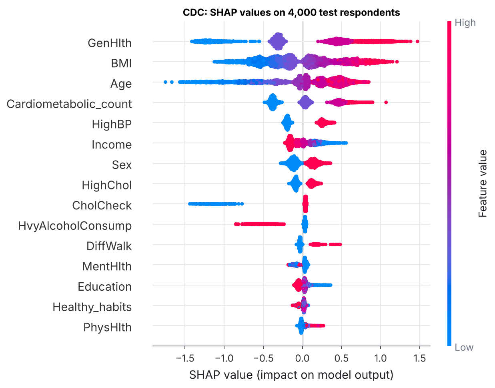

---

# Part 3 · Concepts used, step by step

| Pipeline step | Concept | Where |
|---|---|---|
| Acquisition | Checksum-verified downloads (MD5 from OpenML, pinned SHA-256) | `data.py` |
| Validation | Schema, range and codebook checks; duplicate and label-conflict audit | `validation.py`, `01_validate_data.py` |
| Splitting | Stratified, grouped hold-out; repeated stratified K-fold; nested CV | `02`, `03` scripts |
| Missing data | Domain-informed missingness (impossible zeros), median imputation inside folds, missing indicators (tested) | `02_pima_experiments.py` |
| Features | Cubic splines, one-hot encoding of ordinal answers, clinically motivated counts, interaction terms (tested) | `features.py` |
| Models | Logistic regression (L2), SVM, k-NN, random forest, XGBoost, LightGBM, soft voting, stacking | `02`, `03` scripts |
| Tuning | Grid search in nested CV (Pima); random search over 7 hyperparameters (CDC) | `02`, `03` scripts |
| Imbalance | Class weights, SMOTE inside folds, random undersampling, compared against threshold moving | `imbalance.csv` |
| Model comparison | Nadeau–Bengio corrected resampled t-test | `evaluation.py` |
| Calibration | Brier score, expected calibration error, Platt scaling, conditional isotonic regression | `evaluation.py` |
| Decision making | Threshold chosen for a pre-registered recall target, validated on unseen folds | `evaluation.py` |
| Uncertainty | Fold standard deviations; 1,000-sample bootstrap CIs on the test set | `evaluation.py` |
| Explainability | Odds ratios, spline effect curves, permutation importance, SHAP | `02`, `03` scripts |
| Fairness | Subgroup metrics by sex, age, income and health coverage | `subgroups.csv` |
| Reproducibility | Fixed seeds, pinned library versions, one-command `make all`, unit tests for leakage and metrics | `Makefile`, `tests/` |
